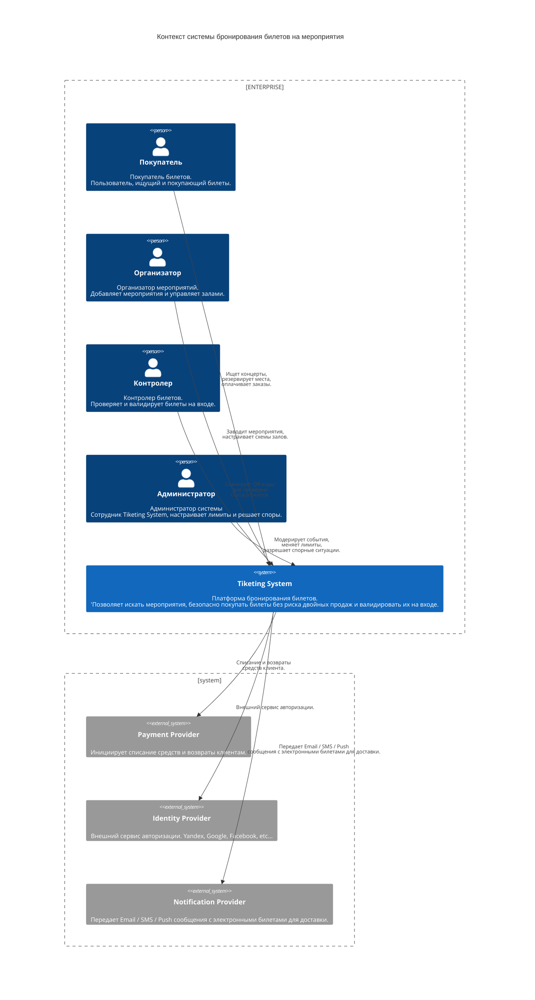

w# ДЗ 6. Проектная работа — решение

> Условие: [../Задание.md](../Задание.md). Схемы — в [diagrams/](diagrams/).

## Выбранная тема

_Система управления мероприятиями — билеты на мероприятия (Tiket Booking System)._

Система управления мероприятиями и продажи билетов — это система, которая позволяет организаторам создавать мероприятия(события) такие как:
- концерты;
- шоу;
- фильмы;
- спектакли;
- спортивные мероприятия;
- и т.д.

Система позволяет организаторам настраивать интерактивные схемы залов, управлять билетами на мероприятие. Покупатели могут быстро находить мероприятия, выбирать места на схеме зала и оплачивать билеты онлайн. Также система обеспечивает проверку билетов контролерами с помощью сканеров на входе на площадку.

Содержание проекта:

### 1. [Требования к системе](<./Требования.md>)
### 2. [Концептуальная архитектура](<./Концептуальная архитектура.md>)
### 3. [Сайзинг](<./Сайзинг.md>)
### 4. [Хранение данных](<./Хранение данных.md>)
### 5. [Взаимодействие](<./Взаимодействие.md>)
### 6. [Надёжность](<./Надёжность.md>)
### 7. [Безопасность](<./Безопасность.md>)
### 8. [Observability](<./Observability.md>)
### 9. [Тестирование](<./Тестирование.md>)

Основные 

## 2. Концептуальная архитектура

```mermaid
C4Container
    title Container diagram for Tiketing System

        Person(personUser, "Покупатель", "Покупатель билетов.<br/>Пользователь, ищущий и покупающий билеты.")
        Person(personOrganizer, "Организатор", "Организатор мероприятий.<br/>Добавляет мероприятия и управляет залами.")
        Person(personController, "Контролер", "Контролер билетов.<br/>Проверяет и валидирует билеты на входе.")
        Person(personAdministrator, "Администратор", "Администратор системы<br/>Сотрудник Tiketing System, настраивает лимиты и решает споры.")

    Container_Boundary(c0, "Client layer") {
        Container(webApp, "Веб-сайт", "JavaScript", "Веб-сайт для бронирования билетов покупателями.")
        Container(mobileApp, "Мобильное бронирование", "Android/iOS", "Мобильное приложение для бронирования билетов покупателями.")
        Container(controllerApp, "Мобильное QR-сканирование", "Android/iOS", "Мобильное приложение для проверки валидности билетов.")
        Container(webAdminPortal, "Веб-сайт", "", "Веб-портал для администрирования.")
    }

    Container_Boundary(c1, "Service layer") {

        Container(ApiGateway, "API Gateway", "Kong / Nginx", "API-шлюз.<br/>- Routing<br/>- Rate Limiting<br/>- Load Balancing<br/>- Authentication")
        Container(UserService, "User Service", "", "-Аутентификация.<br/>- Профиль.")
        Container(CatalogService, "Catalog Service", "", "- Список мероприятий.<br/>- Информация о мероприятии.<br/>- Схема зала.")
        Container(BookingService, "Booking Service", "", "- Блокировка мест.<br/>- Бронирование.<br/>- Менеджмент бронирования.")
        Container(PaymentService, "Payment Service", "", "- Платежный шлюз.<br/>- Обработка сообщений от платежного шлюза.<br/>- Возврат средств.")
        Container(NotificationService, "Notification Service", "", "Рассылка сообщений:<br/>- Email<br/>- SMS<br/>- Push Notifications")
    }
    
    Container_Boundary(c2, "Data & Cache") {
        ContainerDb(postgreSQL, "Основная БД", "PostgreSQL", "- Пользователи<br/>- Бронирования<br/>-Мероприятия / места<br/>- Платежи")
        ContainerDb(redis, "Redis cache", "Redis", "- Распределённый кэш<br/>- Блокировка мест.")
        ContainerDb(elasticsearch, "Search", "Elasticsearch", "- Поиск мероприятий.")
        Container(messageBroker, "Брокер сообщений.", "Kafka", "")
        Container(storage, "Ресурсы", "S3 / CDN", "- Статическое описание мероприятий.<br/>- Схемы залов.<br/>- Билеты.")       
    }

    Boundary(ext, "") {
        System_Ext(extSystemPayment, "Payment Provider", "Инициирует списание средств и возвраты клиентам.")
        System_Ext(extSystemIdentity, "Identity Provider", "Внешний сервис авторизации. Yandex, Google, Facebook, etc...")
        System_Ext(extSystemNotification, "Notification Provider", "Передает Email / SMS / Push сообщения с электронными билетами для доставки.")
    }      

    UpdateLayoutConfig($c4ShapeInRow="4", $c4BoundaryInRow="1")
```





- Схема C4: Context + Container (в diagrams/).
- Описание компонентов (1–2 предложения на каждый).
- Обоснование архитектурного стиля.
- ADR для 2–3 ключевых решений.
- Пользователи и внешние интеграции.

## 3. Сайзинг

_RPS, хранилище, bandwidth, ресурсы и стоимость._

## 4. Хранение данных

_Выбор БД с обоснованием, шардирование, кэширование._


```mermaid
erDiagram
    user ||--o{ user_oauth_accounts : "Аутентифицируется через сторонних провайдеров"
    user ||--o{ refresh_tokens : "Использует"
    user ||--o{ booking : "Оформляет"

    venue ||--o{ venue_zone : "Состоит из"
    venue_zone ||--o{ venue_seat : "Состоит из"

    performer ||--o{ event : "Выступает"
    venue ||--o{ event : "Проходит на"

    

    user {
        uuid id PK
        varchar email UK
        varchar password_hash
        varchar phone_number
        varchar first_name
        varchar last_name
        enum role "CUSTOMER, ORGANIZER, CONTROLLER, ADMIN"
        boolean is_active
        boolean is_email_verified         
        timestamp created_at
        timestamp updated_at
        jsonb metadata
    }

    user_oauth_accounts {
        uuid id PK
        uuid user_id FK
        enum oauth_provider "YANDEX, GOOGLE, FACEBOOK"
        varchar provider_user_id
        timestamp created_at
    } 

    refresh_tokens {
        uuid id PK
        uuid user_id FK
        varchar token_hash 
        text device_info
        varchar ip_address
        timestamp created_at
        timestamp expires_at
        boolean is_revoked
    }

    venue {
        uuid id PK
        varchar name
        varchar city 
        varchar address
        jsonb map_visual_schema
        int total_capacity
        timestamp created_at 
    }

    venue_zone {
        uuid id PK
        uuid venue_id FK
        varchar name
        boolean is_seating
        jsonb zone_visual_schema
        timestamp created_at 
    }

    venue_seat {        
        uuid id PK
        uuid venue_id FK
        uuid venue_zone_id FK
        varchar row_number
        varchar seat_number
        varchar map_element_id
        varchar seat_type
        timestamp created_at 
    }

    performer {
        uuid id PK
        varchar name
        varchar genre
        text description
    }

    event {
        uuid id PK
        varchar title
        text description
        uuid performer_id FK
        uuid venue_id FK
        varchar category
        timestamp begin_time
        timestamp end_time
        numeric(10,2) price_min
        numeric(10,2) price_max
        enum status "DRAFT, ACTIVE, CANCELLED, PAST"
        timestamp created_at
    }


    set_scheme {
        uuid id PK
        uuid venue_id FK
        varchar name
    }

    seat {
        uuid id PK
        uuid scheme_id FK
        varchar row_number
        varchar seat_number
        varchar category "VIP, Standard"
    }

    show {
        uuid id PK
        uuid event_id FK
        uuid venue_id FK
        timestamp start_time
        timestamp end_time
        timestamp created_at
    }

    show_seat {
        uuid id PK
        uuid show_id FK
        uuid seat_id FK
        decimal price
        varchar status "AVAILABLE, LOCKED, SOLD"
        uuid locked_by_user_id FK
        timestamp lock_expires_at "TTL для брони"
        int version "Оптимистичная блокировка"
    }


    Booking {
        uuid id PK
        uuid user_id FK
        enum status "PENDING, CONFIRMED, CANCELLED"
        decimal total_price
        timestamp created_at
        timestamp expires_at
    }

    BookingItem {
        uuid id PK
        uuid booking_id FK
        uuid show_seat_id FK
        decimal price
    }

    Payment {
        uuid id PK
        uuid booking_id FK "Unique"
        varchar external_tx_id UK "Шлюз (Stripe/Adyen)"
        varchar status "PENDING, SUCCESS, FAILED"
        decimal amount
        varchar provider
        timestamp created_at
    }

    OutboxEvent {
        uuid id PK
        varchar aggregate_type "BOOKING, PAYMENT"
        varchar aggregate_id "ID сущности"
        varchar event_type "BookingConfirmed, LockExpired"
        jsonb payload "Данные для брокера"
        varchar status "PENDING, PROCESSED, FAILED"
        text error_reason
        timestamp created_at
        timestamp processed_at
    }

```

## 5. Взаимодействие

_Схема взаимодействия и API-контракты._

