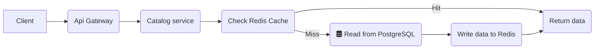
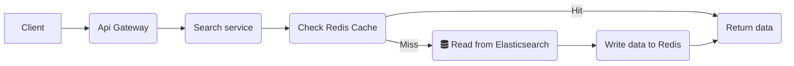
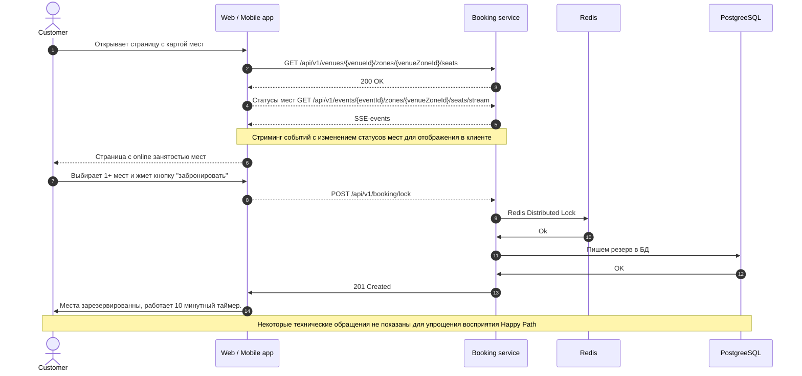
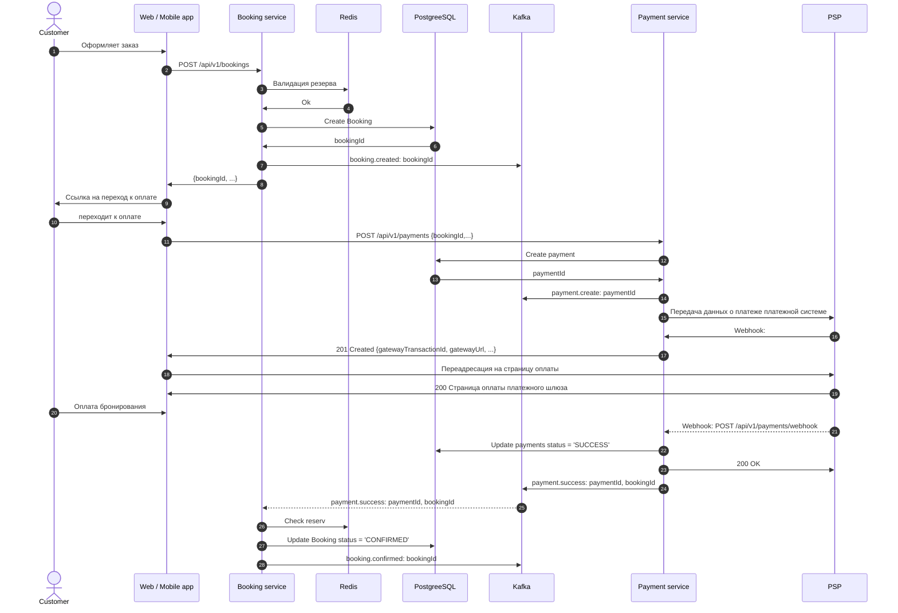

 ## 5. Взаимодействие
 
 ### Схема взаимодействия

### Протоколы взаимодействия

|Между чем и чем| Протокол | Примечание |
| --- | ---  | ---  |
|  Client ⇔ API Gateway | REST HTTP/2 | Основной протокол для взаимодействия клиента и сервера. Ответы без сохранения состояния, с возможностью кэширования на CDN. Стандартные методы HTTP (GET, POST, PUT, DELETE). |
| Routing API Gateway ⇔ Service  | REST HTTP/2 | Просто маршрутизируем исходный запрос без смены протокола. |
| Service ⇔ Service | gRPC | В случаях когда необходимо синхронное взаимодействие между сервисами используем gRPC скорости. |
| Payment service ⇔ Payment Service Provider| REST HTTP/2  | Индустриальный стандарт REST + JSON. Ответы от провайдера в виlt webhoook запросов.|
| Domain events | Apache Kafka + Avro + Schema Registry. | Строгий контроль качества данных. Высокая производительность и экономный формат.  Отвязка схемы от сообщения. |
| Client ⇐ доступность мест online | SSE REST HTTP/2 | SSE cтриминг в норме. Запасной вариант при fallback- пуллинг REST запросами. Фактически требуется односторонняя связь для трансляции состояния - SSE подходит идеально организовывая строго однонаправленный канал данных. |
| Client ⇔ Virtual Waiting Room  | REST HTTP/2 | Виртуальная очередь не треубет online обновления, вполне достаточно раз в 30-60с показать пользователю изменение его места в очереди. При таких условиях взаимодействие через стандартный пуллинг REST-запросами будет значительно экономичнее чем поддержка сотен тысяч каналов для SSE-стримминга или WebSockets. |

### API

[REST API](./docs/openapi/) в формате yaml. 

**Ключевые потоки данных:**

#### Построение поисковых индексов 

Связь между сервисами поиска и каталога работает асинхронно через паттерн CQRS и шину сообщений (Kafka):
1. Запись: Организаторы создают/изменяют мероприятие в сервисе каталога. Данные сохраняются в базу PostgreSQL.
2. Синхронизация: Сервис каталога генерирует событие `event.created` или `event.updated` в Kafka.
3. Индексация : Сервис поиска вычитывает эти сообщение, при необходимости обогащает (например, превращает координаты стадиона в гео-хэш) и сохраняет в специализированное поисковое хранилище — Elasticsearch.

#### Просмотр и поиск

`GET /api/v1/events/{eventId}` - получение детальной информации о событии.

Публичный эндпоинт, аутентификация не нужна, ответ кэшируется в CDN Edge и на уровне Redis.

`GET /api/v1/performers` - поиск исполнителя по названию.

`GET/api/v1/events` - поиск и фильтрация мероприятий

**Кэширование поисковых запросов:**

**1. Кэширование на уровне CDN**

CDN находится ближе всего к пользователю. Однако кэшировать поисковую выдачу на CDN "намертво" нельзя, иначе пользователь увидит билеты на концерт, которых уже нет в продаже.
- Что кэшируется: Только статическая структура и общие (популярные) запросы. Например, главная страница поиска без фильтров ("Все концерты в Лондоне"), списки категорий ("Спорт", "Театр") или поисковые подсказки (Search Autocomplete / Suggestions), когда пользователь только начинает вводить буквы "b-i-l-l-i-e...".
- Стратегия кэширования: Stale-While-Revalidate (SWR). CDN мгновенно отдает пользователю старый (кэшированный) результат поиска, но в фоне отправляет быстрый асинхронный запрос на бэкенд, чтобы обновить кэш для следующего посетителя.
- TTL: Очень короткий — 15 секунд. Этого достаточно, чтобы погасить пиковую волну трафика (например, когда миллион человек одновременно обновляют страницу в 10:00 в момент старта продаж), но при этом данные не устаревают критично.

**2. Кэширование в Redis**

Redis находится внутри периметра системы. Его задача — защитить кластер Elasticsearch от повторных тяжелых запросов.
- Что кэшируется: Конкретные персонализированные поисковые выдачи со сложными комбинациями фильтров (например: q=rock&date=weekend&city=NSK&price_max=15000). Запрос сериализуется, от него берется MD5-хеш, который выступает ключом в Redis.
- TTL: 60 секунд.
- Инвалидация кэша по событиям : если сервис бронирования фиксирует, что билеты на конкретное событие полностью закончились, это событие падает в Kafka. Сервис поиска, поймав его, может принудительно удалить из Redis кэшированные запросы, содержащие это событие, не дожидаясь истечения TTL.

#### Показ схемы зала 

`GET /api/v1/venues/{venueId}/zones/{venueZoneId}/seats/v{version}`

Схема зала представляет из себя сложный, тяжеловесный svg-контейнер размером до 15-20 МБ для больших стадионов. Иногда для особо больших залов или стадионов используют схему деления на сектора, в API предусмотрен такой подход.

Должна располагаться в S3 хранилище, откуда распространяться на CDN, с максимальными агрессивными параметрами кэширования. Для инвалидации использовать параметр `version`. Данный эндпоинт возвращает только статическое изображение зала, занятость зала отображается на клиенте динамически с помощью SSE-стримминга.

#### Доступность мест

`GET /api/v1/events/{eventId}/zones/{venueZoneId}/seats/stream` - cтрим динамических статусов мест (SSE).
`GET /api/v1/events/{eventId}/zones/{venueZoneId}/seats/status` - получение статусов мест методом Pooling (резерв).

В норме должен использоваться SSE-стримминг, однако в случае возникновения проблемм можно использовать резервный эндпоинт для пуллинг статуса мест. 
При первоначальном запросе выгружается полный массив мест со статусами в дальнейшем - только обновления.

#### Процесс выбора и блокировки места

При запросе резервирования мест обязательно использование ключа идемпотентности. Несмотря на атомарность блокировки мест нам необходимо отслеживать повторные обращения и возвращать список ранее зарезервированных для этого ключа мест. Это поможет избежать потери заблокированных мест в случае наличия каких-то сетевых проблем при первом ответе клиенту, а в конечнеом счете повысит удовлетворенность клиентов и конверсию бизнеса.

При обработке запроса на блокировку идентификатор пользователя берем в целях безопасности из JWT-токена. 

По сути механика проверки распределенной блокироовки работает на основе Redis инструкции создания ключа с проверкой `SET seat:{event_id}:seat_id lock_id NX EX 600`. Команда либо успешно создает ключ и записывает value (если ключа не было), либо возвращает пустой ответ. 
Однако так как пользователь может заказать несколько мест то выполнение этих команд производится в LUA-скрипте. Redis гарантирует атомарность выполненения скрипта, т.е. либо все ключи на блокировку создадутся, либо не создаться ни одна.

Redis — это лишь быстрый кэш для защиты БД от высокой нагрузки, источником истины для нас является PostgreSQL. При успешной блокировке в Redis, сервис должен сразу же записать резерв в PostgreSQL. В таблице `event_seat` ставится статус `LOCKED` и `lock_expires_at = NOW() + INTERVAL '10 minutes'`. 

Кроме того для освобождения просроченных броней периодически (раз в 30-60 с) должен запускаться процесс освобождения просроченных блокировок background worker который выполняет освобождение просроченных резервов в БД `UPDATE event_seat SET status = 'AVAILABLE', updated_at = NOW() WHERE status = 'RESERVED' AND lock_expires_at < NOW()` и используя паттерн Transactional Outbox кидает в шину сообщения `booking.seat-release` гарантируя что событие об освобождении места обязятельно поступит в сервис доступности мест.

Для зон свободногго размещения логика немного отличается, в Redis эффективнее хранить общий счетчик с ёмкостью зоны и при бронировании пытаться списывать из нее места, если после списаниясчетчик больше или равен нулю считаем резервацию успешной. Кроме того возникает проблема освобождения мест (инкремента емкости зоны) по истечению TTL. Решается с помощью фонового воркера отслеживающего просроченные резервации. 

Альтернативный способ: создание "фейк"-мест для зон свободного размещения. Тогда логика резервирования будет отличаться только тем, что для зон свободного размещения система будет выделять места не по выбору пользователя а произвольно из свободных в зоне. Однако повысятся объемы генерируемых данных.

#### Процесс бронирования и оплаты

В этой схеме есть критическая точка отказа : что делать, если пользователь оплатил билет, но пока платеж обрабатывался, время резерва в Redis истекло, и места вернулись в общую продажу? 
Для решения этой проблемы будем использовать хореографическую сагу. В ней нет единого контроллера, а каждый сервис слушает топики и знает, какую компенсирующую транзакцию запустить в случае неудачи.
Рассмотрим два сценария: минимизирующий возможность возникновения такой проблемы и компенсирующий.

**1. Профилактический подход: cдвигающийся тайм-аут.**

Чтобы минимизировать саму вероятность коллизии, применяется паттерн "Продление брони при переходе на шлюз":
1. Когда пользователь нажимает "Оплатить" и вызывается POST /api/v1/payments, система оплаты отправляет в шину событие `payment.create`;
2. Система бронирования слушает этот топик и автоматически продлевает TTL блокировки мест в Redis еще на 3–5 минут (время, необходимое на ввод карты и 3D-Secure);
3. Если за эти 5 минут вебхук от банка так и не пришел, бронь сгорает окончательно.

**2. Компенсационная Сага.**

Если таймер всё же истек, места вернулись в пул, их мгновенно купил другой человек, а через секунду прилетает вебхук об успешной оплате от первого пользователя — запускается компенсационный сценарий.

1. Платежный шлюз → Система оплаты: Приходит вебхук SUCCESS (деньги захолдированы/списаны).
2. Система оплаты: Меняет статус транзакции у себя на CAPTURED и публикует в Kafka событие `payment.success` {bookingId, amount}.
3. Система бронирования (cбой бизнес-логики):
	- Считывает `payment.success`;
	- Идет в Redis и видит: бронь отменена по таймауту;
	- Пытается сделать оптимистичную блокировку на те же места снова;
	- Результат: Ошибка, места уже заблокированы или куплены другим пользователем.
4. Система бронирования (запуск компенсации):
	- Публикует в Kafka событие-откат: `booking.failed` {bookingId, paymentId, amount, reason: "SEATS_TAKEN"}.
5. Система оплаты (реакция на компенсацию):
	- Считывает событие `booking.failed`;
	- Понимает, что заказ не может быть выполнен, хотя деньги списаны;
	- Автоматически вызывает метод POST /api/v1/payments/{paymentId}/refund (к внешнему платежному шлюзу) для полной отмены транзакции (Void/Refund);
	- Меняет статус платежа в своей БД на FAILED/REFUNDED.
6. Сервис уведомлений:
	-  Считывает событие `booking.failed` и отправляет пользователю Push/Email: "Извините, время сессии истекло, места были выкуплены. Мы автоматически вернули вам деньги на карту, они поступят в течение 3-5 дней".

**3. Альтернативное предложение.**

Для системы продаж, делать моментальный рефанд — это потеря прибыли и лояльности (пользователь ловил билеты на концерт мечты, ввел карту, у него списали деньги, а система просто вернула их обратно).

Поэтому Сагу можно усложнитиь паттерном автоподбора и это хорошое предложение для бэклога:
1. Вместо публикации `booking.failed`, cистема бронирования проверяет, есть ли на этом же секторе/ряду другие свободные места аналогичной или более высокой категории.
2. Если места есть: Система бронирования автоматически сажает пользователя на них (делает бесплатный апгрейд) и успешно подтверждает заказ (`booking.confirmed-with-changes`).
3. Если свободных мест на стадионе вообще нет: запускается cценарий 2 (полный автоматический возврат денег).

#### Валидация билетов контроллером с помощью мобильного сканера или СКУД-турникетом

`POST /api/v1/controllers/tickets/validate` - валидация билета контроллером.

`POST /api/v1/tickets/gate-pass` - валидация билета СКУД устройством без привязки устройства. 

`POST /api/v1/tickets/{gateId}/gate-pass` - валидация билета СКУД устройством c привязкой устройства.

Сканируется QR код билета представляющий из себя структуру `event_id + event_seat_id + Ed25519-подпись(event_id + event_seat_id)`.
Приватный ключ для генерации QR расположен на бэкенде (Vault), на устройствах имеется публичный ключ для валидации.
Запросы фиксируют проходы по билетам.

### События Kafka

Гарантии доставки событий: Transactional outbox при записи в PostgreSQL ( таблица `outbox_event`) , Transaction Outbox Relay в Kafka (At-Least-Once); Для гарантии идемпротентности консьюмеров используем таблицу `processed_event` и ключ `event-id`.

| Topic | Description | Producer |  Consumers | Payload (core) | 
| --- | --- | --- | --- | --- |
| `booking.seat-lock` | Место временно зарезервировано. | Booking | Seat (availablility) |  `{ lock_id, event_id, seats:[seat_id,...], expires_at }` |
| `booking.seat-release` | С места снят резерв.  | Booking | Seat (availablility) | `{ lock_id, event_id, seats:[seat_id,...], expires_at }` |
| `booking.created` | Бронь создана, ожидает оплаты. | Booking | Payment, Notification  | `{booking_id, lock_id, amount, expires_at}` |
| `booking.confirmed` | Оплата подтверждена, бронь окончательно закреплена. | Booking | Ticket, Notification | `{booking_id, payment_id, amount}` |
| `booking.confirmed-with-changes`| Оплата подтверждена, но в процессе бронирования произошло изменение мест. | Booking  | Ticket, Notification | `{booking_id, payment_id, amount, seats_old:[seat_id,...], seats_new:[seat_id,...]}` |
| `booking.cancelled` | Бронь отменена. | Booking | Seat, Payment, Notification | `{booking_id, payment_id, amount, reason}` |
| `booking.failed` | Ошибка при создании брони. | Booking |  ***Analytics (out of scope)***  | `{booking_id, payment_id, amount, reason}` |
| `payment.create` | Инициализация платежа. | Payment | ***Analytics (out of scope)*** | `{booking_id, payment_id, amount, currency" payment_method}` |
| `payment.success` | Деньги успешно списаны со счета клиента. | Payment | Booking | `{booking_id, payment_id, amount, gateway_transaction_id}` |
| `payment.failed` | Списание денег закончилось неудачей. | Payment | Booking | `{booking_id, payment_id, error_code, error_message}` |
| `notification.preferences.updated` | Пользователь изменил каналы связи или отписался от рассылок. | User | Notification | `{user_id, updated_at, channels_enabled}` |
| `notification.email.sent` | Email успешно ушел провайдеру. | Notification  | ***Analytics (out of scope)*** | `{notification_id, provider_message_id, user_id, recipient_email, template_code, provider_name, sent_at}` |
| `notification.sms.failed` | Ошибка отправки SMS. | Notification | ***Logging (out of scope)*** | `{notification_id, user_id, recipient_phone, provider_name, failed_at, error}` |
|...|...|...|...|
| `tickets.created` | Билеты сгенерированы. |  Ticket | Notification | `{seat_id, booking_id, user_id, event_id, ticket_type, price, currency, qr_raw, expires_at}` |
| `tickets.validated` | Билет был отвалидирован на мероприятии.| Ticket | ***Analytics (out of scope)*** | `{seat_id, booking_id, user_id, event_id,  gate_id, validated_at, status} ` |

[Назад к оглавлению](./Readme.md)