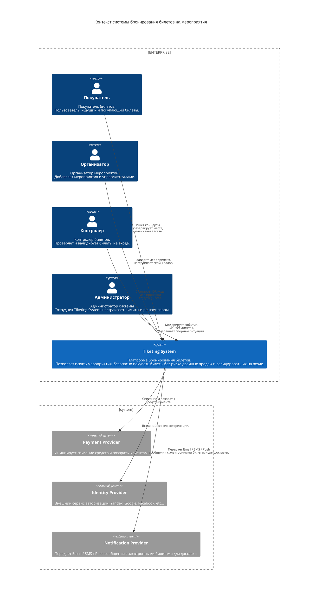
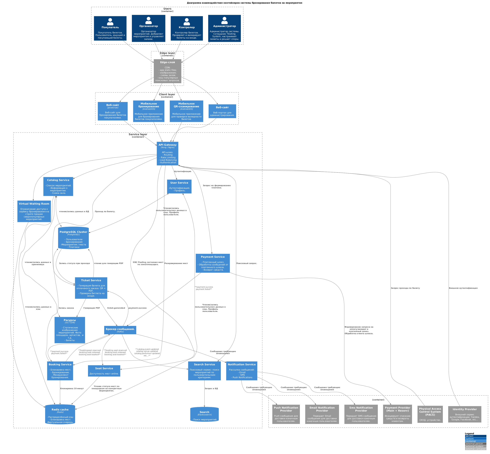

## 2. Концептуальная архитектура

### Контекст системы бронирования билетов на мероприятия

### Диаграмма контейнеров системы бронирования билетов на мероприятия

### Описание компонентов системы

|Компонент|	За что отвечает|
| :--- | :--- |
| Веб-сайт / Мобильное бронирование | Мобильный / веб UI для взаимодействия пользователя с сервисом. Просмотр мероприятий, площадок, поиск, резервирование, оплата, просмотр билетов.|
| Веб-портал организатора | Создание и редактирование площадок. Формирование мероприятий и билетов на них. Формирование схем площадок. |
| Мобильное QR-сканирование / СКУД | Приложение для контроллера проверяющего билет, позволяющее по QR коду проверить корректность билета, также возможна проверка в автоматическом режиме на турникете. |
| API Gateway | API-шлюз. Единая точка входа для всех запросов: отвечает за проверку access token, роутинг запросов, ограничение числа запросов на сервисы.|
| User Service | Сервис отввечающий за аутентификацию пользователй, вход с помощью внешних сервисов аутентификации, регистрацию пользователей, права доступа, роли, профили. |
| Catalog Service | Предосталяет информацию о мерооприятиях, площадках и артистах. |
| Booking Service | Резервирование выбранных мест на время оформления заказа (10 минут) и создание заказа. Гарантирует, что одно место не продастся дважды. |
| Payment Service | Проведение оплаты через внешний платежный шлюз. Осуществление возвратов. Отвечает за выбор  провайдера, обрабатывает ошибки возращаемые от платежного шлюза.|
| Notification Service | Рассылка сообщений для пользователей. Сообщения о успешном / неудачном бронировании, рассылка билетов, напоминания о событиях и т.д. Push, sms, e-mail. |
| Ticket Service | Генерация билета (PDF + QR): уникальный QR-код для проверки на входе. В онлайн режиме можно также проверять уникальность проходов по билету. |
| Search Service | Поисковый сервис. Отвечает за поиск мероприятий, площадок, артистов с учетом доп. параметров: название мероприятия, города, даты, артиста. |
| Virtual Waiting Room | На старте продаж популярного события не пускает всех сразу, а ставит пользователей в очередь и запускает внутрь контролируемым потоком, чтобы система не перегрузилась. |
| PostgreSQL | Информация о пользователях, площадках, мероприятиях, артистах, билетах, бронированиях, платежах. Является источником истины для системы. |
| Redis | Распределённое кэширования + резервация мест. | 
| Apache Kafka | Обеспечивает асинхронный обмен событиями между сервисами. |
| S3 Storage | Хранилище для  статических и медиафайлов не требующих мгновенного обновления в СУБД. |

### Обоснование архитектурного стиля

В качестве архитектурного подхода к реализации системы выбрана микросервисная асинхронная архитектура (event-driven + CQRS) [ADR-001](./docs/adr/adr_001_architecture_style.md).

Обоснование:

- Система бронирования характеризуется резкой асимметрией в пользу чтения, которая может достигать экстремальных значений в моменты старта продаж. Операции чтения генерируют подавляющую часть трафика (более 95%). На операции записи приходится малая доля трафика, но эти операции критически важны для бизнеса. Выбранный стиль позволяет раздельно маштабировать сервисы отвечающие за чтение в моменты напрлыва пользовательского интереса и сервисы отвечающие за бронирование и проводку платежей.

- Различные части системы используют разные гарантии согласованности, основанные на компромиссах между бизнес-рисками и производительностью.

| Домен | Согласованность | Обоснование |
| :--- | :--- | :--- |
| Резервирование места  | Сильная | Предотвращает одновременное занятие одного и того же места двумя пользователями. |
| Бронирование места | Сильная | Овербукинг мест недопустим. |
| Платежи | Сильная | Строгая финансовая корректность. |
| Информация о наличии мест | Итоговая | Небольшие задержки допустимы. Фактическое состояние мест будет перепроверяться при попытках бронировая с сильной согласованностью.|
| Показ каталога | Итоговая | Незначительные задержки допустимы. Кэширование для повышения производительности. |
| Результаты поиска | Итоговая | Допустима задержка обновления поисковых индексов. Небольшие расхождения приемлимы. |
| Уведомления | Итоговая | Отсутствие бизнес-рисков при незначительных задержках.|

- Изоляция сбоев. Сбои в сервисе генерации билетов не помешают пользователю осуществить покупку, а наличие шины сообщений гарантирует что при восстановлении сервисов все необходимые  действия будут проведены.

- Шина сообщений. Наличие шины позволяет повысить эластичность сервисов за счет сглаживания пиков посредством буфферизации; возможности динамического горизонтальное масштабирования и значительного ослабления связанности сервисов. 

### Пользователи и внешние интеграции

**Пользователи:**
- покупатели;
- организаторы;
- администраторы системы;
- контроллёры на входе;

**Внешние интеграции:**

| Система | Назначение | Протокол |
| :--- | :--- | :--- |
| Платёжный шлюз | Предоставляет сервис для проведения оплаты, предоставляет возможности выбора различных методов оплаты, мультиэквайринг, конвертация валют и т.д. | HTTP / REST API |
| Identity Provider | Предоставляет возможность пользователю использовать привычные / удобные средства аутентификации.   | HTTP / OAuth 2.0 OIDC |
| СКУД-турникеты | Онлайн валидация и регистрация прохода по билету | HTTP / REST API |
| Шлюз push уведомлений | Отправка push уведомлений на устройства пользователя | HTTP / REST API |
| Шлюз e-mail уведомлений | Отправка e-mail уведомлений на адрес(а) пользователя | HTTP / REST API , SMTP |
| Шлюз SMS уведомлений| Отправка SMS уведомлений на телефон пользователя | HTTP / REST API |

[Назад к оглавлению](./Readme.md)