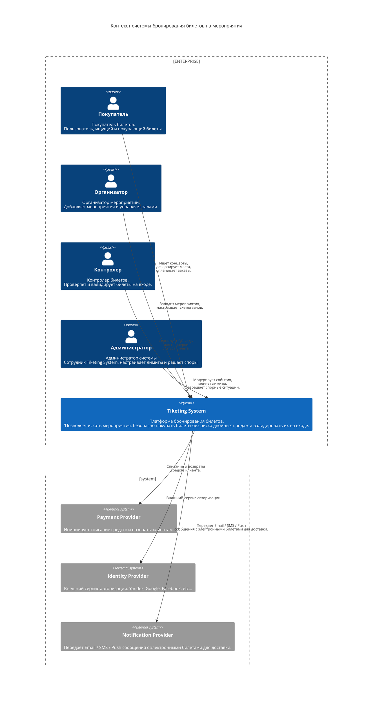

## 2. Концептуальная архитектура

```mermaid
C4Container
    title Container diagram for Tiketing System

        Person(personUser, "Покупатель", "Покупатель билетов.<br/>Пользователь, ищущий и покупающий билеты.")
        Person(personOrganizer, "Организатор", "Организатор мероприятий.<br/>Добавляет мероприятия и управляет залами.")
        Person(personController, "Контролер", "Контролер билетов.<br/>Проверяет и валидирует билеты на входе.")
        Person(personAdministrator, "Администратор", "Администратор системы<br/>Сотрудник Tiketing System, настраивает лимиты и решает споры.")

    Container_Boundary(c0, "Client layer") {
        Container(webApp, "Веб-сайт", "JavaScript", "Веб-сайт для бронирования билетов покупателями.")
        Container(mobileApp, "Мобильное бронирование", "Android/iOS", "Мобильное приложение для бронирования билетов покупателями.")
        Container(controllerApp, "Мобильное QR-сканирование", "Android/iOS", "Мобильное приложение для проверки валидности билетов.")
        Container(webAdminPortal, "Веб-сайт", "", "Веб-портал для администрирования.")
    }

    Container_Boundary(c1, "Service layer") {

        Container(ApiGateway, "API Gateway", "Kong / Nginx", "API-шлюз.<br/>- Routing<br/>- Rate Limiting<br/>- Load Balancing<br/>- Authentication")
        Container(UserService, "User Service", "", "-Аутентификация.<br/>- Профиль.")
        Container(CatalogService, "Catalog Service", "", "- Список мероприятий.<br/>- Информация о мероприятии.<br/>- Схема зала.")
        Container(BookingService, "Booking Service", "", "- Блокировка мест.<br/>- Бронирование.<br/>- Менеджмент бронирования.")
        Container(PaymentService, "Payment Service", "", "- Платежный шлюз.<br/>- Обработка сообщений от платежного шлюза.<br/>- Возврат средств.")
        Container(NotificationService, "Notification Service", "", "Рассылка сообщений:<br/>- Email<br/>- SMS<br/>- Push Notifications")
    }
    
    Container_Boundary(c2, "Data & Cache") {
        ContainerDb(postgreSQL, "Основная БД", "PostgreSQL", "- Пользователи<br/>- Бронирования<br/>-Мероприятия / места<br/>- Платежи")
        ContainerDb(redis, "Redis cache", "Redis", "- Распределённый кэш<br/>- Блокировка мест.")
        ContainerDb(elasticsearch, "Search", "Elasticsearch", "- Поиск мероприятий.")
        Container(messageBroker, "Брокер сообщений.", "Kafka", "")
        Container(storage, "Ресурсы", "S3 / CDN", "- Статическое описание мероприятий.<br/>- Схемы залов.<br/>- Билеты.")       
    }

    Boundary(ext, "") {
        System_Ext(extSystemPayment, "Payment Provider", "Инициирует списание средств и возвраты клиентам.")
        System_Ext(extSystemIdentity, "Identity Provider", "Внешний сервис авторизации. Yandex, Google, Facebook, etc...")
        System_Ext(extSystemNotification, "Notification Provider", "Передает Email / SMS / Push сообщения с электронными билетами для доставки.")
    }      

    UpdateLayoutConfig($c4ShapeInRow="4", $c4BoundaryInRow="1")
```

- Схема C4: Context + Container (в diagrams/).
- Описание компонентов (1–2 предложения на каждый).
- Обоснование архитектурного стиля.
- ADR для 2–3 ключевых решений.
- Пользователи и внешние интеграции.

[Назад к оглавлению](./Readme.md)