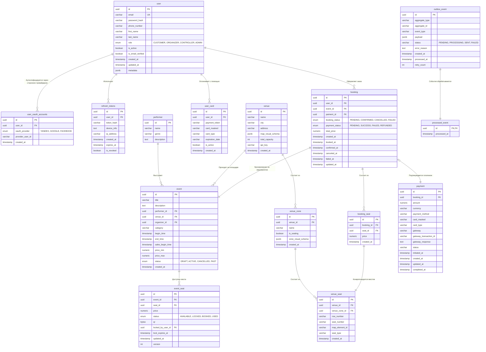

## 4. **Хранение данных**

| Что используем | Как и где используем  | Обоснование |
| :--- | :---: | :--- |
| **PostgreSQL** | Booking & Payment | Требуется ACID, поддержка транзакций и строгая консистентность данных. [ADR-003](./docs/adr/adr_003_database_selection.md).|
| **Redis** | Booking | [ADR-004](./docs/adr/adr_004_distributed_transactions.md).  |
| **Elasticsearch** |  Searching | Elasticsearch обеспечивает высокую скорость обработки поисковых запросов благодаря архитектуре инвертированного индекса и горизонтальному масштабированию (шардированию), которые позволяют осуществлять мгновенный поиск по ключевым словам без полного сканирования базы данных. |
| **Apache Kafka** | Booking & Payment, Notifications, QR | Позволяет сгладить пиковые нагрузки и осуществлять асинхронные взаимодействия. |
| **S3 Storage** | Event Content & Catalog Service, Ticket Generation & Delivery | Используется в качестве масштабируемого хранилища для постоянного хранения статических данных, таких как изображения билетов, схем площадок, медиаконтент мероприятий и исторические логи. Это позволяет разгрузить базы данных и обеспечивать мгновенную отдачу тяжелых статических файлов пользователям через интеграцию с CDN. |

### Масштабирование

**PostgreSQL**

Используем кластер репликации из 1 Primary и 3-х Standby реплик. В качестве UUID используем UUIDv7 для оптимизации скорости работы с индексами.

Запись осуществляется в Primary, операции чтения - в основном из реплик для снижения io-нагрузки на primary db. 

Обработка задержек репликации:
- Критические операции чтения (статус места) → Primary;
- Некритические операции чтения (каталог мероприятий, площадки) → Standby;
- Согласованность чтения после записи для собственных бронирований пользователя.

**Redis**

Redis Cluster
- 3 Master-ноды (шардируем по event_id)
- 3 Replica-ноды

**Elasticsearch**

Сервис поиска не относится к критически важным элементам системы, для системы будет достаточно минимального отказоустойчивого кластера из 3-х нод.

**S3 Storage**

Учитывая объемы данных хранимых в файловом хранилище, я бы предположил разумность использования сторонних S3 Object Storage. 
В случае же если потребуется развертывание self-hosted S3 Storage, конкретная конфигурация зависит от того, какое именно объектное хранилище будет использоваться. Как правило минимальный отказоустойчивый кластер формируется из 3-5 нод.

### Диаграмма сущностей

### Схема шардирования

**Redis**

Redis Cluster
- 3 Master-ноды (шардируем по event_id)
- 3 Replica-ноды

Стратегия шардирования:
Sharding Strategy:
- Lock keys: Shard by show_id
- Cache keys: Shard by entity type
- Session keys: Shard by user_id

### Стратегия кэширования

#### Где кэшируем

**Кэш браузера**

| Сущности | Время кэширования | Пример данных / Патерн ключа |
| :--- | :--- | :--- |
| Статические ресурсы приложения (`main.css`, `bundle.js`, `logo.png`, etc...)| 1 week |  |
| Изображения связанные с мероприятием | 1 day |  |

**Кэш CDN**

| Сущности | Время кэширования | Пример данных / Патерн ключа |
| :--- | :--- | :--- |
| Изображения фильмов и постеры | 7 days | `https://example.com` |
| Изображения кинотеатров | 7 days | `https://example.com` |
| Статические страницы | 1 hour | Главная страница, О проекте, Контакты |

**L3: Кэш Redis (уровень приложений)**

| Сущности | Время кэширования | Пример данных / Патерн ключа |
| :--- | :--- | :--- |
| Каталог фильмов (Movie Catalog) | 1 hour | `movie:{movieId}`   `{id, title, description, poster, rating, ...}` |
| Информация о кинотеатре (Theater Info) | 1 hour | `theater:{theaterId}`   `{id, name, city, screens, ...}` |
| Расписание сеансов (Show Listings) | 5 minutes | `shows:city:{city}:date:{date}:movie:{movieId}`   `[{showId, theater, time, price, ...}]` |
| Доступность мест (Seat Availability - HOT DATA) | 30 seconds | `seats:show:{showId}`   `{available: ["A1", "A2"], booked: ["B1"], locked: ["C1"]}` |
| Блокировка мест (Seat Locks - CRITICAL) | 10 minutes | `lock:show:{showId}:seat:{seatId}`   `{userId}:{lockId}` |
| Сессии пользователей (User Sessions) | 24 hours | `session:{sessionId}`   `{userId, email, ...}` |
| Детали бронирования (Booking Details) | 1 hour | `booking:{bookingId}`   `{id, status, seats, amount, ...}` |

#### Стратегия аннулирования кэша

Write-Through Pattern (for critical data):
- Update DB first
- Then update cache
- Ensures consistency

Write-Behind Pattern (for analytics):
- Update cache first
- Async update DB
- Better performance

Cache-Aside Pattern (for reads):
- Check cache first
- On miss, fetch from DB
- Update cache
- Return to client

Invalidation Events:

1. Seat booked → Invalidate seats:show:{showId}
2. Show cancelled → Invalidate all show-related keys
3. Theater updated → Invalidate theater:{id}
4. Movie updated → Invalidate movie:{id}

Invalidation Flow:
┌──────────┐      ┌──────────┐      ┌─────────┐
│  Service │─────>│ Database │─────>│  Cache  │
│          │      │  UPDATE  │      │ INVALID │
└──────────┘      └──────────┘      └─────────┘
     │                                     │
     └─────> Publish Event ────────────────┘
             (Kafka: cache.invalidate)

####  Прогрев кэша

Предварительное заполнение кэша перед периодами пиковой нагрузки:

1. Популярные мероприятия — кэширование в полночь;
2. Мероприятия выходного дня — кэширование в полночь с пятницы на субботу;
3. Новинки — кэширование за 1 день до выхода;
4. Популярные площадки — если площадки подразумевают частые мероприятия (например кинотеатр) кэширование каждый час.

Фоновые задачи:
- Запускаем с квантированием в час;
- Выявляем популярный контент;
- Заранее заполняем кэш;

[Назад к оглавлению](./Readme.md)