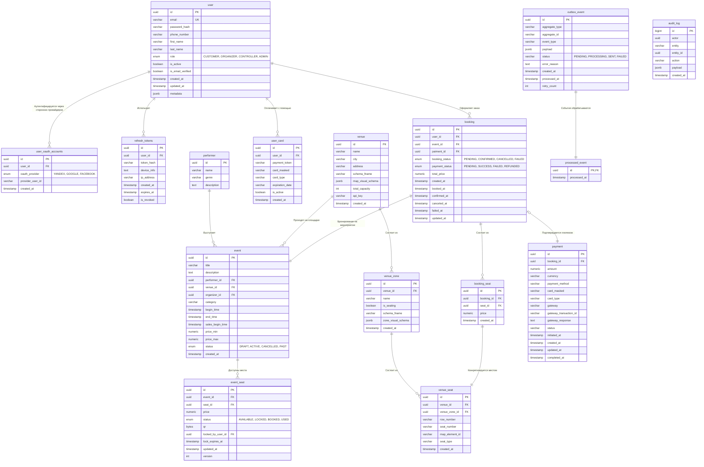

## 4. **Хранение данных**

| Что используем | Как и где используем  | Обоснование |
| :--- | :---: | :--- |
| **PostgreSQL** | Booking & Payment | Требуется ACID, поддержка транзакций и строгая консистентность данных. [ADR-003](./docs/adr/adr_003_database_selection.md).|
| **Redis** | Booking, Catalog, Search | [ADR-004](./docs/adr/adr_004_distributed_transactions.md).  |
| **Elasticsearch** |  Searching | Elasticsearch обеспечивает высокую скорость обработки поисковых запросов благодаря архитектуре инвертированного индекса и горизонтальному масштабированию (шардированию), которые позволяют осуществлять мгновенный поиск по ключевым словам без полного сканирования базы данных с учетом языковой морфологии. |
| **Apache Kafka** | Booking & Payment, Notifications, Tickets | Транспорт позволяющий осуществлять асинхронные взаимодействия менжду сервисами. Позволяет сгладить пиковые нагрузки. |
| **S3 Storage** | Event Content & Catalog media, Tickets | Используется в качестве масштабируемого хранилища для постоянного хранения статических данных, таких как изображения билетов, схем площадок, медиаконтент мероприятий и исторические логи. Это позволяет разгрузить базы данных и обеспечивать мгновенную отдачу тяжелых статических файлов пользователям через интеграцию с CDN. |


**PostgreSQL**

PostgreSQL — основной источник истины в системе, общая база данных используемая сервисами приложения.

Содержит информацию о: 
- пользователях системы; 
- площадках включая топологию посадочных мест (за исключением карты мест);
- мероприятиях;
- артистах/исполнителях;
- бронированиях;
- платежах;
- а также дополнительные служебные данные для обеспечения целостности системы.


**Redis**

Примерный список ключей используемых в Redis. Есть примеры ключей относящихся к критическому уровню приложения (`jwt:bl:{jti}`, `seat:{event_id}:seat_id`), а также примеры ключей относящихся к вспомогательному уровню (`event:{eventId}:details`, `search:{hash(query)}`).

| Ключ | Тип | Значение | TTL | Описание |
| --- | --- | --- | --- | --- |
| `jwt:bl:{jti}` | STRING | `_` | динамически для каждого токена (`оставшееся время жизни токена`) | Кэш поисковых запросов.  |
| `session:{session_id}` | HASH | данные сессии | 24 часа | Сессии пользователей |
| `{waitingroom:{eventId}}:queue` | ZSET | Member: `queueToken` (UUID) Score: Timestamp (время входа) | 12 часов | Очередь ожидания. Сортирует пользователей по времени захода на сайт.  |
| `{waitingroom:{eventId}}:active_users` | ZSET | 	Member: queueToken (UUID) Score: Timestamp дедлайна (now + 15 min) | до конца онсейла | Контроль емкости шлюза. Фоновый воркер ежесекундно удаляет тех, чье время на покупку истекло. |
| `waitingroom:{eventId}:pass:{queueToken}` | STRING | `_` | 15 мин | Входной билет на бэкенд. Валидируется на API-Gateway при каждом клике. |
| `seat:{event_id}:seat_id` | STRING | `lock_id` | 10 мин | Блокировка места.  |
| `seats:{event_id}` | HASH | `{seat_id, status}` | без TTL (прогрев) | Полная карта статусов нумерованных мест горячего события — источник для Availability Service (F-C-04); для отрисовки схемы зала. Агрегаты для каталога — отдельный ключ `avail:*` |
| `event:{eventId}:venue_zones:free_count` | HASH | `[{zone_id, count}]` | 10 с| количество свободных мест в зоне на событие |
| `event:{eventId}:details` | STRING | `JSON-строка с метаданными (название, дата, описание, баннеры, цены)` | Без TTL | Кэш страницы события. Разгружает основную БД от миллионов запросов "чтения" карточки мероприятия. Инвалидируется организатором через сервис каталога при изменении события. |
| `venue:{venueId}:details` | STRING | `JSON-строка с метаданными (название, описание, адрес, контакты)` | Без TTL | Кэш страницы площадки. Разгружает основную БД от  запросов "чтения" карточки площадки. Инвалидируется организатором через сервис каталога при изменении площадки. |
| `performer:{performeId}:details` | STRING | `JSON-строка с метаданными (название, описание, etc)` | Без TTL | Кэш артиста/исполнителя. Разгружает основную БД от  запросов "чтения" карточки артиста. Инвалидируется организатором через сервис каталога при изменении данных об артисте. |
| `search:{hash(query)}` | STRING | `JSON-строка с метаданными результатов` | 60 с | Кэш поисковых запросов. |
|`negative_cache:{type}:{id}`| STRING | `символ маркер` или `строка с данными` имеющими смысл в конкретной области применений ключа.| 300 c | Ключ негативных запросов. Дэмпфирует нагрузку на БД при запросе отстутствующих ключей.  |


**Elasticsearch**

Используется как высокоскоростной поисковый движок с возможностями полнотекстового поиска, фильтрации и гео-пространственного анализа. Обслуживает пользовательский контур. 
**Не хранит** транзакционные данные!
Данные в Elasticsearch попадают через Kafka из основной СУБД PostgreSQL.


Примеры поисковых индексов:

1. Индекс мероприятий

    Этот индекс собирает данные из таблиц event, performer и venue. Он денормализован: вместо внешних ключей (FK) мы вкладываем основные текстовые поля и геолокацию, чтобы обеспечить мгновенный поиск.

    Пример документа (JSON):
    ```json
    {
    "id": "e3b0c442-98fc-4c14-951c-000000000001", 
    "title": "Баста. Большой концерт на стадионе",
    "description": "Масштабное шоу Василия Вакуленко в Лужниках. Все хиты, живой звук и грандиозная визуальная программа.",
    "category": "Рэп и Хип-хоп",
    "status": "ACTIVE",
    "begin_time": "2027-06-20T16:00:00Z",
    "end_time": "2027-06-20T19:00:00Z",
    "sales_begin_time": "2026-11-01T09:00:00Z",
    "price_min": 1500.00,
    "price_max": 25000.00,
    "created_at": "2026-10-26T14:00:00Z",
    "organizer_id": "9b1deb4d-3b7d-4bad-9bdd-2b0d7b3dcb6d",
    "performer": {
        "id": "a4f0c881-22fc-4b31-851c-111111111111",
        "name": "Баста",
        "genre": "Рэп",
        "alternative_names": ["Василий Вакуленко", "Ноггано", "Нинтендо", "Basta"]
    },
    "venue": {
        "id": "c5e0d993-33fc-4c32-951c-222222222222",
        "name": "БСА "Лужники"",
        "city": "Москва",
        "address": "г. Москва, ул. Лужники, д. 24",
        "schema_fname": "luzhniki_main_2027.json",
        "location": { "lat": 55.7158, "lon": 37.5537 } 
    },
    "tags": ["rap", "stadium", "live", "хиты"]
    }
    ```
2. Индекс площадок / стадионов

    Этот индекс строится на основе таблицы venue. Поля schema_fname и 

    Пример документа (JSON):

    ```json
    {
    "id": "c5e0d993-33fc-4c32-951c-222222222222",
    "name": "ВТБ Арена (Центральный стадион "Динамо")",
    "city": "Москва",
    "address": "г. Москва, Ленинградский пр-т, д. 36",
    "schema_fname": "vtb_arena_combined.json",
    "total_capacity": 33000,
    "location": {
        "lat": 55.7915, "lon": 37.5595
    },
    "created_at": "2025-01-15T12:00:00Z"
    }
    ```

3. Индекс исполнителей

    Создается на базе таблицы performer. Сюда мы добавляем массив синонимов alternative_names для реализации размытого поиска (Fuzzy Search), чтобы защитить систему от опечаток пользователей при вводе.
    
    Пример документа (JSON):
    ```json
    {
    "id": "d6f1e004-44fc-4d43-951c-333333333333",
    "name": "Полина Гагарина",
    "genre": "Поп",
    "description": "Российская эстрадная певица, актриса кино, телевидения, композитор и фотомодель.",
    "alternative_names": ["Гагарина", "Polina Gagarina", "Палина Гагарина", "Gagarina"],
    "popularity_score": 95
    }
    ```

**Apache Kafka**

Топики используемые в Apache Kafka подробно описаны в документе [Взаимодействие](./Взаимодействие.md)

**S3 Storage**

Выбор S3 Storage в качестве файлового хранилища обусловлен тремя критическими факторами, которые напрямую закрывают требования к доступности, масштабированию и безопасности:

1. Встроенное гео-резервирование (Выполнение RPO/RTO)
    - При сбое AZ (RPO=0, RTO=0): S3 по умолчанию реплицирует каждый загруженный файл (будь то постер Басты или PDF-билет) в 3 зоны доступности внутри региона. Падение одной AZ никак не влияет на доступность файлов и не требует переключений от дежурных.
    -  При катастрофе региона: Технология S3 Cross-Region Replication (CRR) автоматически и асинхронно перебрасывает тяжелую статику (карты залов, афиши) в DR-регион в фоновом режиме. Это позволяет уложиться в жесткий RTO ≤ 4 часа, так как в момент аварии нам не нужно тратить время на перенос терабайтов картинок.

2. Защита ядра от файловой нагрузки
    - Рендеринг карт: Интерактивные визуальные схемы стадионов (map_visual_schema из таблицы venue) весят много. Если отдавать их напрямую из PostgreSQL, база моментально исчерпает пул соединений и утилизирует сетевой канал.
    -  Прямая раздача (Direct Download): cервис генерирует PDF-билет, сохраняют его в S3 и отдаёт пользователю только временную защищенную ссылку (Pre-signed URL). Клиенты скачивают билет напрямую из S3 разгружая микросервисы.

3. Экономическая эффективность и бесконечное масштабирование
    - Пиковые нагрузки: В моменты открытия больших продаж на сайт одновременно заходят сотни тысяч пользователей. S3 масштабируется по запросам автоматически и выдерживает практически любые импульсные нагрузки на чтение статики.
    - Стоимость хранения: База билетов и отчетов организаторов растет линейно с каждым концертом. Хранить исторические файлы в S3 в разы дешевле, чем раздувать дисковые массивы (EBS/NVMe) для дорогой СУБД PostgreSQL.

### Диаграмма сущностей



| Таблица | Описание |
| --- | --- | 
| `user` | Пользователь в системе. |
| `user_oauth_accounts` | Аккаунты сторонних провайдеров связанных с пользователем для аутентификации через внешних провйдеров. |
| `user_card` | Платежные карты пользователя. |
| `refresh_tokens` | Refrsesh tokens для верификации выдачи access token. |
| `venue` | Площадка для проведения мероприятий. |
| `venue_zone` | Зона/сектор на площадке мероприятия. |
| `venue_seat` | Место на площадке мероприятия. |
| `performer` | Артист/исполнитель. |
| `event` | Мероприятие. |
| `event_seat` | Место/билет продаваемое на мероприятие. |
| `booking` | Бронирование. |
| `booking_seat` | Бронирование места на мероприятие. |
| `payment` | Платёж. |
| `outbox_event` | Служебная таблица для реализации паттерна Transactional Outbox. |
| `processed_event` | Служебная таблица для гарантии идемпротентности вычитываемых событий. |
| `audit_log` | Аудит лог системы. |


### Масштабирование

**PostgreSQL**

Используем кластер репликации из 1 Primary и 3-х Standby реплик. В качестве UUID используем UUIDv7 для оптимизации скорости работы с индексами.

Запись осуществляется в Primary, операции чтения - в основном из реплик для снижения io-нагрузки на primary db. 

Обработка задержек репликации:
- Критические операции чтения (статус места) → Primary;
- Некритические операции чтения (каталог мероприятий, площадки) → Standby;
- Согласованность чтения после записи для собственных бронирований пользователя.


Паhтиционирование:
1. `event_seat`
    Тип партиционирования: Hash Partitioning.

    Ключ партиционирования: event_id.


2. `booking`и `booking_seat`
    
    Тип партиционирования: Range Partitioning.

    Ключ партиционирования: created_at (по месяцам).


3. `payment`
    Тип партиционирования: Range Partitioning.

    Ключ партиционирования: created_at

4. `outbox_event`

    Тип партиционирования:Range Partitioning.
    Ключ партиционирования: created_at (по дням)

    Обоснование: Скрипт-релей постоянно вычитывает записи со статусом PENDING, отправляет их в Kafka и переводит в SENT. Таблица постоянно пухнет от старых логов. Партиционирование по дням позволяет дежурному раз в неделю просто делать DROP PARTITION для логов за прошлую неделю вместо тяжелой операции DELETE, которая вызывает жесткую фрагментацию диска (Bloat).

5. `audit_log`

    Тип партиционирования: Range Partitioning
    Ключ партиционирования: created_at (по месяцам).


Окно горячих данных: 12 месяцев. Документы (не справочники!) старше уходят из PostgresSQL в системы аналитики.


**Redis**

Redis Cluster
- 3 Master-ноды (шардируем по event_id)
- 3 Replica-ноды

Используем 2 кластера с разными целями и  задачами, из разнык контуров: 
- Критический контур (Redis booking, Tier1 ) - хранение критической информации.
- Вспомогательный контур (Redis cache, Tier2) - хранение кэша.


Tier1
|| Redis Tier1  | Redis Tier2 | 
|---|---|---|
| Основная задача| Хранение 10 минутных распределенных блокировок, сессий авторизации,черных списков токенов, Virtual Waiting Room. Каждый ключ имеет финансовую или защитную ценность.| Кэширование страниц, защита PostgreSQL от ботов (негативный кэш), кэш поиска . Данные являются лишь временной копией того, что лежит в PostgreSQL.|
| Макс. лимит памяти`maxmemory`|Жесткий (Hard limit). Выделяется фиксированный объем RAM (например, 16 ГБ). Память не должна утилизироваться кэшем.||
| Политика вытеснения `maxmemory-policy`| `noeviction` (Категорически запрещено удалять ключи)| `allkeys-lru` |
| Поведение при нехватке памяти|Redis перестает принимать новые брони и возвращает приложению ошибку OOM command not allowed. | Redis автоматически и незаметно для приложения удаляет старый или редко запрашиваемый кэш. |
| Сброс на диск (Persistence)| Включен на максимум: AOF (Append Only File) в режиме appendfsync everysec + регулярные RDB снимки. | Отключен полностью. |

1. Контур Tier 1: Redis booking
    
    - Стратегия `noeviction`: При достижении лимита maxmemory Redis просто заблокирует операции записи (`SET`, `HSET`, `XADD`), но продолжит отвечать на чтение. Требует аларма прогнозирующего такую ситуацию и автоматической реакции в виде горизонтального расширения кластера (добавлению новых шард).
    - Очистка памяти: Память в этом контуре очищается строго естественным путем:
	- Либо по истечении бизнес-TTL (10 минут на оплату билета).
	- Либо принудительно командой `DEL` со стороны сервиса бронирования, когда пользователь сам отменил заказ или успешно завершил платеж.
    - Если этот инстанс перезагрузится  и у него не будет включена персистентность:
        -  Все забаненные боты и угнанные токены снова станут валидными;
        -  Все заблокированные места "освободятся", что моментально повысит нагрзку на БД.
    Для предотвращения такой ситуации используем персистентность: снэпшот + журнал операций для быстрого восстановления данных.


2. Контур Tier 2: Redis cache

    Этот контур работает в условиях постоянного штурма со стороны пользователей и ботов-парсеров.
	- Для кэш-инстанса выставляется агрессивная политика `allkeys-lru`. При наплыве ботов, которые генерируют миллионы уникальных случайных ID для негативного кэша (`negative_cache:{type}:{id}`), Redis при заполнении памяти начнет мгновенно стирать те "негативные" ключи, которые боты затребовали всего один раз и забыли, освобождая RAM под "горячий" легитимный кэш реальных мероприятий.


**Elasticsearch**

Сервис поиска не относится к критически важным элементам системы, для системы будет достаточно минимального отказоустойчивого кластера из 3-х нод.

**S3 Storage**

Учитывая объемы данных хранимых в файловом хранилище, я бы предположил разумность использования сторонних S3 Object Storage. 
В случае же если потребуется развертывание self-hosted S3 Storage, конкретная конфигурация зависит от того, какое именно объектное хранилище будет использоваться. Как правило минимальный отказоустойчивый кластер формируется из 3-5 нод.


### Схема шардирования

**Redis**

Redis Cluster
- 3 Master-ноды (шардируем по event_id)
- 3 Replica-ноды


### Стратегия кэширования

#### Где кэшируем

| Уровень | Что храним? | Стратегия TTL | Поведение при DR (Failover) |
| --- | --- | --- | --- |
| Браузер | Статика (.js, .css, картинки), UI-компоненты. | Длинный (до 1 года) с кэш-брейкингом в именах файлов. | Независим от аварии на бэкенде. Снижает нагрузку на сеть. |
| CDN | Публичные API-ответы, медиа-контент, страницы каталогов. | Средний (минуты/часы) + stale-while-revalidate. | Главный щит. Отдает кэш пользователям, пока бэкенд переключается в DR. |
| Redis | Сессии, тяжелые SQL-запросы, профили пользователей, метаданные. | Короткий/Средний (секунды-часы) в зависимости от типа данных. | Требует "прогрева". |


1. Уровень браузера

    Цель — максимально изолировать пользователя от запросов к серверу для неизменяемых ресурсов.
    - Что храним: Скомпилированный фронтенд (JS-бандлы, CSS-стили), шрифты, логотипы, тяжелые медиа-файлы.
    - Стратегия TTL и заголовки:
	    - Cache-Control: max-age=31536000, immutable (1 год) для файлов с хэшем в названии (например, main.a1b2c3.js). При обновлении приложения имя файла изменится, и браузер скачает новый.
	    - Cache-Control: no-cache для динамического index.html, чтобы браузер всегда проверял актуальность версии приложения на сервере через ETag.

2. Уровень CDN

    Цель — удерживать read-path трафик на периферии сети. Во время DR-переключения CDN берет на себя роль "подушки безопасности".
    - Что храним: Публичные (общие для всех) данные API: списки товаров, популярные статьи, конфигурационные файлы, справочники, результаты поисковых запросов, медиа-файлы.
    - Стратегия TTL:
	    - Edge TTL: от нескольких секунд до 30 минут в зависимости от данных.
	    - Заголовки управления: Cache-Control: public, max-age=300, stale-while-revalidate=60.
    - Особая фишка для DR: Использование директивы stale-while-revalidate или настроек CDN Origin Shield / Serve Stale on Error. Если во время аварии бэкенд не отвечает, CDN продолжит отдавать пользователям старый кэш вместо ошибки 5xx.

3. Уровень Redis (Прикладной кэш)

    Цель — снизить нагрузку на основную и резервную базы данных (особенно в режиме Pilot Light, где ресурсы БД в DR могут быть ограничены).


####  Прогрев кэша


| Категория контента | Триггер запуска (Когда греем) | Источник данных / Механизм | Цель оптимизации |
| :--- | :--- | :--- | :--- |
| **Супер-релизы (Старты продаж)** | За **2 часа** до наступления `sales_begin_time` из таблицы `event`. | Автоматический `K8s CronJob` опрашивает СУБД раз в час и принудительно собирает страницы будущих топ-концертов. | Полная готовность кэша к импульсному наплыву фанатов. Исключение DDoS-эффекта на СУБД в секунду старта продаж. |
| **Вирусный контент (Тренды)** | **Мгновенно** при фиксации всплеска RPS на API Gateway / CDN. | Метрики Edge-серверов CDN → шина `Kafka` → кэш-воркер. Если страницы нет в Redis, она собирается на лету. | Автоматическая защита от внезапных анонсов и ссылок в соцсетях артистов (эффект Тейлор Свифт / Басты). |
| **Уикенд-контур** | **Четверг в 18:00** и **Пятница в 11:00** (в периоды планирования досуга). | Фоновый воркер собирает топ-200 мероприятий на выходные для конкретного города (`city` из таблицы `venue`). | Покрытие пика потребительского выбора перед выходными и во время пятничного бизнес-ланча. |
| **Площадки (Кино/Театры)** | **По факту изменений** расписания или схем залов в B2B-кабинете. | Паттерн *Transactional Outbox* (`outbox_event`) → `Kafka` → воркер инвалидации кэша. | Избавление от ежечасных холостых запросов к PostgreSQL. Большой TTL кэша площадок в "мирное время". |

####  Защита кэша

| Проблема | Паттерн защиты | Инфраструктурная реализация в Ticketmaster | Целевые параметры и настройки |
| :--- | :--- | :--- | :--- |
| **Cache Stampede** | CDN Request Collapsing + Локальный Redis Mutex (`SET NX`) | На внешнем периметре CDN (Cloudflare) схлопывает дублирующиеся запросы к карточкам супер-релизов. Внутри только один микросервис захватывает блокировку через `SET NX` для обновления данных из PostgreSQL, пока остальные отдают пользователям старый (`stale`) кэш. | • Таймаут лока на пересчет: **≤ 5 сек**.<br>• Отдача `stale`-данных: **Разрешена**. |
| **Cache Penetration** | Универсальный негативный кэш на типе данных `string` | Запросы несуществующих ID мероприятий, артистов или штрих-кодов билетов от ботов-парсеров перехватываются в `Redis cache` по маске ключей. Запрос отбивается за доли миллисекунды, полностью изолируя СУБД PostgreSQL от мусорного трафика. | • **TTL: 5 минут (300 сек)**.<br>• Вытеснение в Redis: `allkeys-lru` (для защиты RAM от переполнения уникальными ID ботов). |
| **Cache Avalanche** | Рандомизация времени жизни ключей (Jitter) | При событийном или фоновом прогреве топ-мероприятий (например, за 2 часа до старта продаж) кэш-воркер искусственно подмешивает случайный временной сдвиг к базовому TTL для каждой страницы, размывая нагрузку обновления СУБД во времени. | **Джиттер: ±20%** к базовому TTL. |


[Назад к оглавлению](./Readme.md)